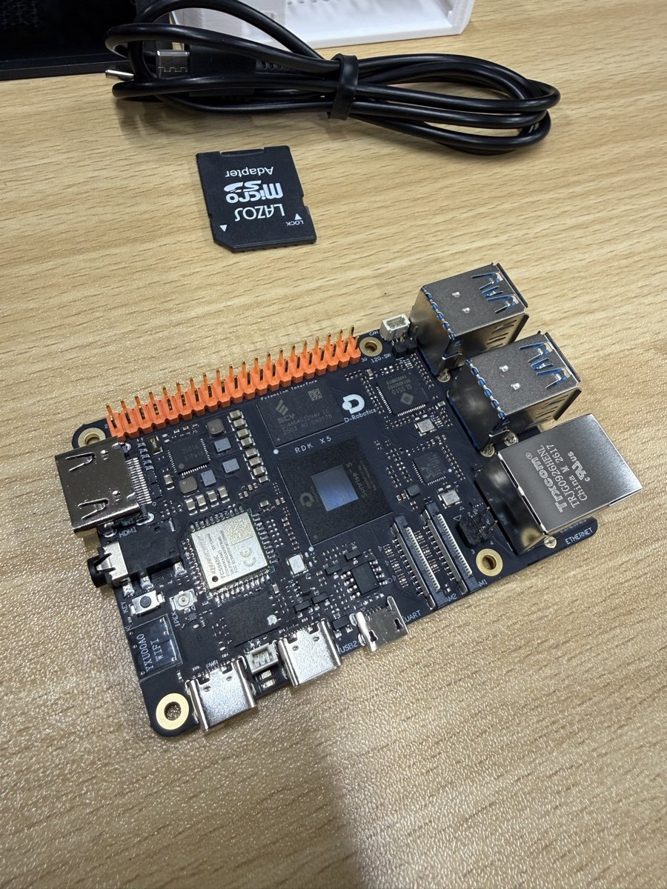
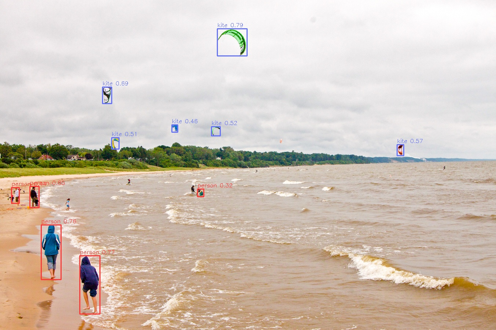

# RDK X5 Home Court Robot — Stage 1

My entry for the **Robotics Dream Keeper Challenge 2026 Winter**.

Project idea: a **home court robot**. RDK X5 is the brain: it watches the living room with a camera and detects events on the BPU, so video never leaves the house. My StackChan is the body: it turns to the person speaking and announces a verdict.

This repository starts with Stage 1 (Ignite): board bring-up, a camera, and a first on-device AI task.

日本語：RDK X5 の冬チャレンジの作品リポジトリです。ステージ1として、ボードの起動・SSH・USB カメラ・BPU での YOLO11 物体検出までを動かしました（2026-10-31、DUG Tokyo #1 にて）。



## Stage 1 status (2026-10-31)

| Challenge | Result | Evidence |
| --- | --- | --- |
| 1. Board bring-up | Connected with RDK Studio (Type-C direct) and logged in over SSH | [01-ssh-system-info.txt](evidence/01-ssh-system-info.txt) |
| 2. Sensor | USB camera on `/dev/video0` (USB), captured 640×480 frames | Re-shoot planned (the first shots include other people's faces, so they are not published) |
| 3. First AI task | YOLO11n object detection on the BPU, 28.4 FPS / about 25 ms per frame with the live camera | [03-yolo11-kite.jpg](evidence/03-yolo11-kite.jpg) |



## Hardware

- D-Robotics RDK X5 (board lent at the venue)
- Power adapter on the `PWR` port, Mac connected to the `USB2` port
- USB camera: ELECOM UCAM-C0220F
- Mac (Apple silicon) with RDK Studio 1.5.2

## Software

- System image: Ubuntu 22.04.5 LTS, kernel 6.1.83, RDK OS 3.5.0
- Official sample: `/app/pydev_demo/02_detection_sample/02_ultralytics_yolo11` (preinstalled on the image)
- Model: `yolo11n_detect_bayese_640x640_nv12.bin` (COCO, 80 classes)
- Python 3, OpenCV (`cv2`), ffmpeg (all preinstalled on the image)

## Setup

1. Connect the board with RDK Studio using **RDK Type-C direct**. RDK Studio asks for the Mac's administrator password in its own dialog to set up the network.
2. The board appears at `192.168.128.10` (the Mac side gets `192.168.128.100`).
3. Use a dedicated SSH key for the board, kept outside `~/.ssh` and outside this repository:

```bash
ssh-keygen -t ed25519 -N "" -f ~/Developer/rdk-keys/id_rdk -C "rdk-x5@mac"
```

Add the public key to `/root/.ssh/authorized_keys` on the board from the RDK Studio terminal, then:

```bash
ssh -i ~/Developer/rdk-keys/id_rdk -o UserKnownHostsFile=~/Developer/rdk-keys/known_hosts root@192.168.128.10
```

## Commands

Check the camera and take one frame:

```bash
ls /dev/video*
ffmpeg -loglevel error -y -f v4l2 -video_size 640x480 -i /dev/video0 -frames:v 1 /root/stage1/cam.jpg
```

Run the official YOLO11 sample on an image:

```bash
cd /app/pydev_demo/02_detection_sample/02_ultralytics_yolo11
python3 ultralytics_yolo11.py \
  --model-path yolo11n_detect_bayese_640x640_nv12.bin \
  --test-img kite.jpg \
  --label-file coco_classes.names \
  --img-save-path /root/stage1/yolo11_kite.jpg
```

Live detection in a browser ([live_web.py](live_web.py)): USB camera → YOLO11 on the BPU → MJPEG over HTTP. It reuses the class from the official sample.

```bash
scp -i ~/Developer/rdk-keys/id_rdk live_web.py root@192.168.128.10:/root/stage1/
ssh -i ~/Developer/rdk-keys/id_rdk root@192.168.128.10 'cd /root/stage1 && nohup python3 live_web.py > live_web.log 2>&1 &'
```

Open `http://192.168.128.10:8080` on the Mac. To view it from a phone on the same Wi-Fi, forward the port through the Mac:

```bash
ssh -i ~/Developer/rdk-keys/id_rdk -N -L 0.0.0.0:8080:127.0.0.1:8080 root@192.168.128.10
```

## Troubleshooting

- **`No route to host` from the Mac's Terminal app, while RDK Studio can reach the board.** Probably macOS Local Network permission for the Terminal app (not confirmed). Check System Settings → Privacy & Security → Local Network.
- **No `/dev/video*`.** The camera was not detected yet when the system info was taken. Plug the camera into a USB-A port on the board and check `lsusb` and `ls /dev/video*` again.
- **Which port is which.** `PWR` is for the power adapter only. Use `USB2` for the Mac. `UART` is not needed for this setup.
- **Do not publish secrets.** Keep the SSH key, Wi-Fi passwords and device serials out of the repository. Camera images with other people in them are not published either.

## Next

- Re-shoot the camera evidence with objects only
- Stage 1 update on Discord and the showcase PR (by 2026-11-10)
- Stage 2: design the home court robot (RDK X5 + StackChan)
