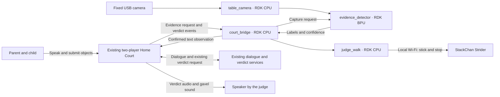

# Home Court Robot — Stage 2 architecture

## Game interfaces

- Evidence. The tabletop adapter connects to the existing `submitEvidence()` step. RDK X5 runs the YOLO11n detection model on a fresh frame from the marked evidence area. It proposes a label and timestamps the observation. The game confirms it with the player and passes the label in the existing evidence list to `/api/verdict`, together with the corresponding spoken explanation in the case record. Frames stay on the RDK. On an unclear view, the existing oral explanation is sufficient to continue.
- Walking. `judge(call)` emits one deliberation event after validating `call_judge` and setting the existing duplicate guard. The RDK sends a brief forward command while the judges deliberate. The adapter stops the walk at the start of verdict speech, at the walk deadline, or on any motion error. Verdict speech and the existing `sfx.gavel()` play in their usual order and proceed independently of a motion acknowledgment.
- RDK CPU handles ROS 2, image crop, postprocessing, the event IDs, and the bounded walk. The BPU runs object inference. The existing off-board services continue to handle speech and verdicts. The RDK sends the tabletop observation as text.

| Module | Input and output | Failure behavior |
| --- | --- | --- |
| `table_camera` | USB UVC to timestamped frames, 640 × 480 target | Capture freshness check, then request a new view |
| `evidence_detector` | Fresh evidence-area image to candidate labels, confidences, and frame stamp | Report unclear and permit oral evidence |
| `court_bridge` | Existing game events and evidence result to confirmed evidence note and walk action | Idempotency by case ID and event ID. Verdict still plays after a device error. |
| `judge_walk` | One walk goal to Strider HTTP commands over Wi-Fi. Sends stop and reports completion. | Cancels on audio start, timeout, or connection error. The Strider watchdog stops the drive if control messages cease. |

## ROS 2 Humble interfaces

| Direction | Name | Type and target rate |
| --- | --- | --- |
| Camera → detector | `/table/image_raw` | `sensor_msgs/msg/Image`, 15 Hz target |
| Bridge → detector | `/court/observe_evidence` | `home_court_msgs/srv/ObserveEvidence`, one request per submission. Response carries frame stamp, labels, and confidence. |
| Bridge → motion | `/court/judge_walk` | `home_court_msgs/action/JudgeWalk`, one goal per accepted verdict. Deadline and case ID in goal. Cancel at audio start. |
| Motion → bridge | `/court/judge_walk/status` | `home_court_msgs/msg/JudgeWalkStatus`, state transitions with timestamps |

The walk node uses the pinned Strider firmware's `/api/stick?x=0&y=…` and `/api/stop`. Renew the forward command every 300 ms during the active period. The upstream controller stops after 900 ms without a command. Confirm stop behavior on the actual hardware before the full demo. [Strider controller source](https://github.com/Yeq6X/stackchan-strider/blob/852ae848d90ea7e85ada61842ec20ac88a86a82b/firmware/src/main.cpp)

[Proposal](proposal.md) · [Engineering plan](engineering-plan.md)
